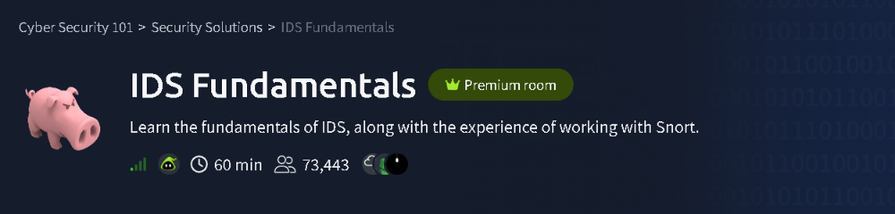
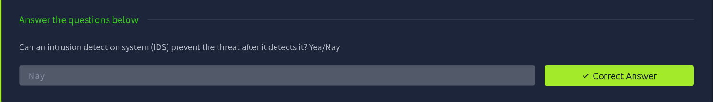
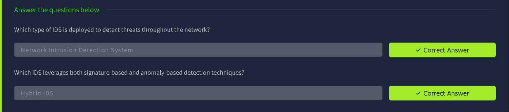
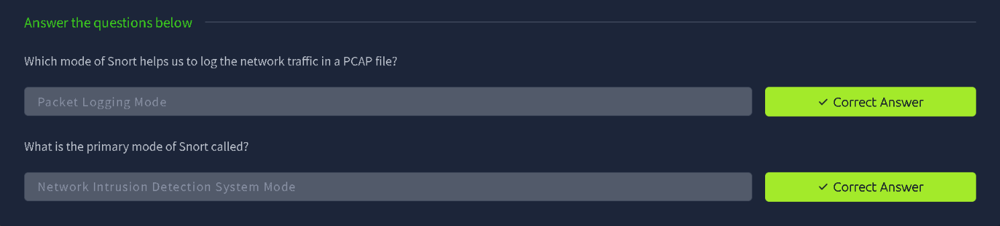
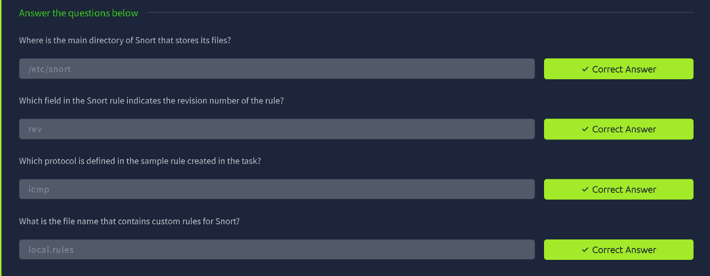
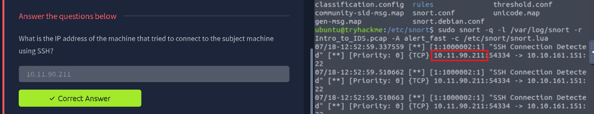
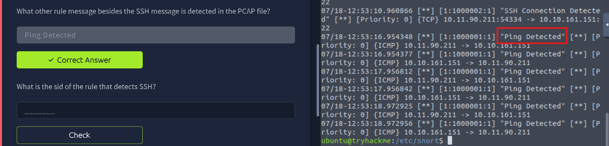
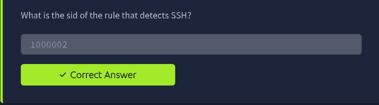

# TryHackMe: IDS Fundamentals

> **Track:** Cyber Security 101 → Security Solutions
> **Difficulty:** Easy · **Time:** ~60 min
> **Focus:** What an Intrusion Detection System (IDS) is, the main IDS types, and hands-on use of **Snort** to analyse a PCAP file with custom rules



---

## Summary

An IDS watches traffic or host activity and raises alerts when it sees something suspicious. This room explains how IDS differs from IPS, the types of IDS and their detection methods, then puts you on a machine running **Snort**, where you read rules and replay a packet capture to see which rules fire.

| Part | What I did |
|---|---|
| Concepts | IDS vs IPS, IDS types (NIDS, HIDS, hybrid) and detection methods |
| Snort basics | Snort's modes, main directory, rule fields and the custom rules file |
| Hands-on | Run Snort against a PCAP, find the SSH source IP, find the other alert, and read the rule SID |

---

## Step 1: IDS vs IPS

An **IDS** *detects* and alerts. It does **not** block or stop the threat. Stopping it is the job of an **IPS** (Intrusion Prevention System), which sits in-line and can drop traffic.

So an IDS cannot prevent a threat after detecting it (the room's Yea/Nay answer is **Nay**).



**Takeaway:** Detection and prevention are different jobs. An IDS gives you visibility, and a human or another tool has to respond.

---

## Step 2: Types of IDS

| Type | What it covers |
|---|---|
| **Network IDS (NIDS)** | Deployed to detect threats **across the network** by inspecting traffic |
| **Host IDS (HIDS)** | Runs on a single host and watches local activity (files, processes, logs) |
| **Hybrid IDS** | Combines approaches, using **both signature-based and anomaly-based** detection |

Detection methods in brief:

- **Signature-based:** matches known bad patterns. It is accurate for known threats but misses new ones.
- **Anomaly-based:** compares activity against a baseline of normal behaviour. It can catch new threats but may produce more false positives.



**Takeaway:** Network-wide visibility points to NIDS, and mixing detection techniques points to a hybrid IDS.

---

## Step 3: Snort Modes

**Snort** is an open-source IDS/IPS. It operates in three main modes:

| Mode | Purpose |
|---|---|
| **Sniffer mode** | Reads packets and shows them on screen |
| **Packet Logging mode** | **Logs network traffic to a file (PCAP)** |
| **Network Intrusion Detection System (NIDS) mode** | Applies rules to traffic and raises alerts. This is Snort's **primary mode** |



---

## Step 4: Snort Files and Rules

### 4.1 Where things live

- Snort's main directory is **`/etc/snort`**.
- Custom rules are written in the file **`local.rules`**.

### 4.2 Anatomy of a rule

A Snort rule has a header (action, protocol, source, destination) and options in parentheses. Two fields matter here:

- **`rev`** is the **revision number** of the rule.
- **`sid`** is the **unique rule ID**. IDs from 1,000,000 up are reserved for local, custom rules.

The sample rule built in the room uses the **`icmp`** protocol (it detects pings).



**Takeaway:** Putting custom rules in `local.rules` keeps them separate from the vendor rule sets, so updates won't overwrite them.

---

## Step 5: Hands-On, Running Snort Against a PCAP

The practical gives a capture file, `Intro_to_IDS.pcap`, and a configuration with custom rules already in place. The task is to replay the capture through Snort and read what it flags.

### 5.1 Move into Snort's directory and run Snort

```bash
cd /etc/snort
sudo snort -q -l /var/log/snort -r Intro_to_IDS.pcap -A alert_fast -c /etc/snort/snort.lua
```

What each option does:

| Option | Meaning |
|---|---|
| `-q` | **Quiet** mode, suppressing the startup banner and statistics |
| `-l /var/log/snort` | Directory to write **logs** to |
| `-r Intro_to_IDS.pcap` | **Read** packets from this PCAP file instead of a live interface |
| `-A alert_fast` | Print alerts in the compact **fast** one-line format |
| `-c /etc/snort/snort.lua` | Use this **configuration** file (which loads the rules) |

### 5.2 Find who tried to connect over SSH

The output lists alerts from the custom SSH rule. Each line reads:

```
[**] [1:1000002:1] "SSH Connection Detected" [**] [Priority: 0] {TCP} 10.11.90.211:54334 -> 10.10.161.151:22
```

Reading the line: the source is **`10.11.90.211`** (port 54334) and the destination is `10.10.161.151` on **port 22**, the SSH port. So `10.11.90.211` is the machine that tried to SSH into the subject machine.



### 5.3 Find the other detection

Scrolling further down the output shows a different rule message in the same capture: **"Ping Detected"**, with `{ICMP}` traffic going back and forth between the two hosts.



### 5.4 Read the SID of the SSH rule

Alert lines follow the format `[GID:SID:REV]`. In `[1:1000002:1]` the middle number is the **SID**, so the SSH-detecting rule has SID **`1000002`**. (The ping rule's SID is `1000001`.)



**Takeaway:** In an alert, `[1:1000002:1]` reads as generator 1, **SID 1000002**, revision 1. Matching the SID back to a rule lets you see exactly why it fired.

---

## Note on the Flag

The questions in this room are answered directly in the answer fields, and there is **no separate flag to capture**, so nothing needed redacting.

---

## Key Takeaways

1. An **IDS detects and alerts**, while an **IPS** can block.
2. **NIDS** watches the network, **HIDS** watches a host, and a **hybrid IDS** mixes signature-based and anomaly-based detection.
3. Snort has three modes (sniffer, packet logging, **NIDS**), with NIDS as the primary one.
4. Custom rules go in **`local.rules`** under **`/etc/snort`**.
5. `snort -r <pcap> -A alert_fast -c <config>` replays a capture and prints alerts, a quick way to triage network evidence.
6. Alert lines show **source → destination**, which immediately answers "who connected to what, and on which port".

## Skills Practised

`IDS / IPS Concepts` · `Snort` · `PCAP Analysis` · `Snort Rules (sid, rev)` · `Alert Triage` · `Linux CLI`

---

*Room: [IDS Fundamentals](https://tryhackme.com/room/idsfundamentals) on TryHackMe.*
